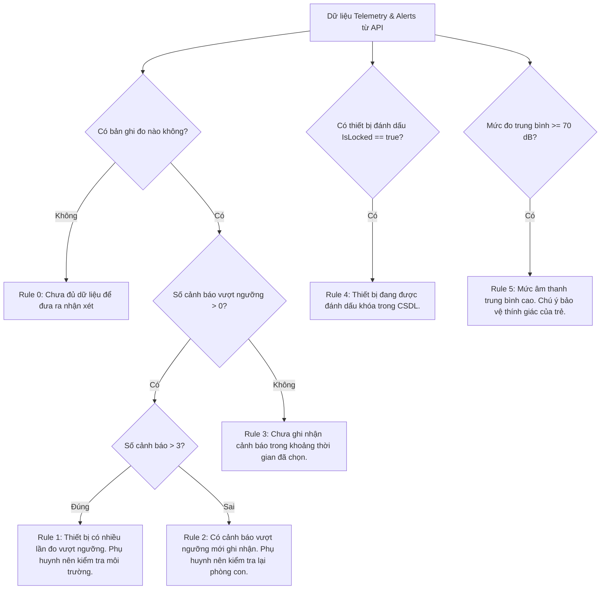

# BÁO CÁO THỰC HIỆN TASK 05.2: GÓC AN TOÀN GIA ĐÌNH — KIDGUARD SAFETY INSIGHTS

- **Dự án:** KidGuard — Hệ thống Quản lý và Giám sát Thiết bị Trẻ em
- **Đơn vị / Nhóm bài tập:** Nhóm 13
- **Tên sinh viên / Định danh:** `NguyenDucChiNguyen_1486`
- **Mã nguồn dự án:** `D:\haha\NguyenDucChiNguyen_1486`
- **Ngày thực hiện:** 22/10/2026
- **Trạng thái:** **HOÀN THÀNH 100% (TESTS PASS: 96/96)**

---

## 1. MÔ TẢ TÍNH NĂNG SÁNG TẠO (KIDGUARD SAFETY INSIGHTS)

Tính năng sáng tạo **"Góc An Toàn Gia Đình — KidGuard Safety Insights"** được xây dựng nhằm hướng tới tiêu chí **1.0 điểm sáng tạo** trong đề kiểm tra môn *Xây dựng ứng dụng di động*.

### 1.1. Mục Tiêu & Giá Trị
Khắc phục nhược điểm của các ứng dụng quản lý thiết bị thông thường (vốn chỉ dừng lại ở danh sách CRUD tĩnh với các trường tên máy, model, số phút giới hạn), **KidGuard Safety Insights** là một **Trung Tâm Giám Sát Chủ Động (Active Safety Insights Hub)**:
- **Tổng hợp thông tin đa chiều:** Tự động đối chiếu và gom dữ liệu đo âm lượng môi trường (decibel) từ tất cả các máy con của phụ huynh theo trục thời gian thực.
- **Phát hiện cảnh báo vi phạm:** Nhận diện ngay lập tức các sự kiện vượt ngưỡng âm thanh an toàn do phụ huynh thiết lập.
- **Phân tích xu hướng trực quan:** Biểu đồ xu hướng số lần vượt ngưỡng theo từng ngày (7 ngày qua, 30 ngày qua, tất cả) cùng thống kê mức đo trung bình và mức đỉnh (dB).
- **Hệ thống gợi ý an toàn minh bạch (Rule-based Safety Suggestions):** Đưa ra các khuyến nghị kiểm tra môi trường dựa trên sự kiện vi phạm thực tế, không dùng "hộp đen" AI hay phỏng đoán vô căn cứ.
- **Xử lý cảnh báo tại chỗ (In-Place Acknowledgment):** Phụ huynh có thể bấm "Xác nhận đã xem" ngay trên danh sách sự kiện, lập tức đồng bộ trạng thái về CSDL backend thông qua HTTP PUT.

---

## 2. ĐIỂM KHÁC BIỆT VỚI CRUD CƠ BẢN

| Tiêu Chí So Sánh | Danh Sách Thiết Bị CRUD Cơ Bản | Góc An Toàn Gia Đình (Safety Insights Hub) |
| :--- | :--- | :--- |
| **Bản chất hiển thị** | Bảng danh sách dòng độc lập, đơn lẻ (tên, model, phút khóa). | Trung tâm tổng hợp đa chiều (Cross-Device Telemetry & Aggregation). |
| **Dữ liệu tiếng ồn** | Chỉ xem được chỉ số đo gần nhất của 1 máy khi mở chi tiết. | Quét và tổng hợp lịch sử đo của toàn bộ máy con do phụ huynh quản lý. |
| **Trục thời gian** | Không có thống kê theo thời gian. | Hỗ trợ bộ lọc 7 ngày qua, 30 ngày qua, và toàn thời gian. |
| **Biểu đồ & Xu hướng** | Không có biểu đồ. | Biểu đồ cột Material 3 thống kê số lần vượt ngưỡng theo ngày, avg/max dB. |
| **Tương tác cảnh báo** | Muốn xem phải vào từng máy. | Gom tất cả cảnh báo chưa xem vào 1 màn hình; xác nhận đã xem tại chỗ. |
| **Hỗ trợ ra quyết định** | Phụ huynh tự đọc số và tự đoán. | Có thẻ gợi ý an toàn minh bạch dựa trên quy tắc vi phạm thực tế. |
| **Xử lý dữ liệu trống** | Màn hình trống không có hướng dẫn. | Empty State phân tầng rõ ràng: *"Chưa đủ dữ liệu để phân tích xu hướng"*. |

---

## 3. DANH MỤC API BACKEND SỬ DỤNG (READ-ONLY TUYỆT ĐỐI)

Tuân thủ nghiêm ngặt nguyên tắc **READ-ONLY 100% đối với `backend-group/`**, tính năng chỉ sử dụng các endpoint chuẩn đã có sẵn của nhóm:

| Phương Thức | Endpoint Backend | Quyền (Role) | Chức Năng Trong Safety Insights |
| :--- | :--- | :--- | :--- |
| `GET` | `/api/ChildDeviceApi` | `Parent` (JWT) | Lấy danh sách các thiết bị thuộc quyền phụ huynh đăng nhập. |
| `GET` | `/api/ChildDeviceApi/{id}` | `Parent` (JWT) | Lấy thông tin chi tiết của từng thiết bị con. |
| `GET` | `/api/ChildDeviceApi/{id}/noise?from=...&to=...&take=...` | `Parent` (JWT) | Lấy lịch sử đo decibel của thiết bị theo khoảng thời gian được lọc. |
| `GET` | `/api/ChildDeviceApi/noise-alerts?take=100` | `Parent` (JWT) | Lấy danh sách các bản ghi cảnh báo vượt ngưỡng chưa xác nhận (`NoiseAlertDto`). |
| `PUT` | `/api/ChildDeviceApi/noise-alerts/{eventId}/ack` | `Parent` (JWT) | Xác nhận phụ huynh đã xem cảnh báo (chuyển cờ `IsAcknowledged`). |
| `PUT` | `/api/ChildDeviceApi/{id}/noise-threshold` | `Parent` (JWT) | Cho phép điều chỉnh ngưỡng an toàn áp dụng cho thiết bị con. |

> [!NOTE]
> Không thêm mới bất kỳ Web API Controller nào, không sửa DTO/Entity của C# ASP.NET Core, không sửa SQL Server schema hay migration.

---

## 4. DANH MỤC FILE FLUTTER TẠO MỚI & SỬA ĐỔI

1. **`mobile/lib/screens/safety/family_safety_insights_screen.dart` (TẠO MỚI - ~1319 dòng):**
   - Màn hình chính Góc An Toàn Gia Đình với kiến trúc Material 3 hiện đại.
   - Chặn phân quyền `currentUser.isParent` (Child bị từ chối với `_buildAccessDeniedState()`).
   - Header, bộ lọc thiết bị (`FilterChip`) và bộ lọc thời gian (`SegmentedButton`).
   - 4 Thẻ tổng quan Overview Cards (Tổng thiết bị, Đang khóa DB, Cảnh báo tiếng ồn, Chưa xác nhận).
   - Thẻ gợi ý an toàn dựa trên quy tắc (`_buildSafetySuggestionsSection()`).
   - Thẻ phân tích xu hướng (`_buildTrendAnalysisSection()`) kèm biểu đồ cột tùy biến chống tràn layout.
   - Danh sách chi tiết sự kiện cảnh báo kèm nút "Xác nhận đã xem" trực tiếp.
   - Bảng công bố phương pháp luận (`_buildMethodologyDisclosure()`).

2. **`mobile/lib/screens/dashboard/parent_dashboard_screen.dart` (SỬA ĐỔI):**
   - Bổ sung lối vào Sub-card C0: **"Góc An Toàn Gia Đình"** tại nhóm **Theo Dõi & Quản Lý**.
   - Thiết kế nổi bật với huy hiệu *"Sáng Tạo • KidGuard Safety Insights"*, chip thống kê thiết bị & cảnh báo mới, dẫn trực tiếp vào màn hình Insights.
   - Hoàn toàn giữ nguyên các tính năng CRUD thiết bị, QR Scanner và Face AI.

3. **`mobile/lib/models/noise_model.dart` (SỬA ĐỔI):**
   - Mở rộng model `NoiseEventModel`: bổ sung trường `childName`, `deviceName`, getter `formattedTime`, phương thức `copyWith(...)`.
   - Constructor `fromJson` đa năng hỗ trợ cả bản ghi `NoiseEvent` (từ lịch sử đo) và `NoiseAlertDto` (từ endpoint `/noise-alerts`).

4. **`mobile/lib/services/noise_service.dart` (SỬA ĐỔI):**
   - Nâng cấp `getNoiseHistory(int deviceId, {DateTime? from, DateTime? to, bool alertsOnly = false, int take = 100})` để hỗ trợ lọc theo ngày bắt đầu và kết thúc (`from`/`to`).

5. **`mobile/test/safety_insights_test.dart` (TẠO MỚI - 16 Test Cases Tự Động):**
   - Bộ kiểm thử toàn diện cho Task 05.2 bao gồm phân quyền, đọc dữ liệu, lọc thiết bị, empty/error states, và kiểm tra chống RenderFlex overflow trên 4 kích thước màn hình ở tỷ lệ chữ 1.0 và 1.3.

---

## 5. THUẬT TOÁN THỐNG KÊ & QUY TẮC GỢI Ý AN TOÀN

Hệ thống gợi ý được thiết kế theo nguyên tắc **Minh Bạch & Dựa Trên Sự Kiện (Rule-Based Facts)**:



### Các Ràng Buộc Đạo Đức & Kỹ Thuật Tuyệt Đối:
1. **KHÔNG** đưa ra kết luận y tế, chẩn đoán tâm lý hay trạng thái sức khỏe của trẻ.
2. **KHÔNG** phỏng đoán trẻ đang gặp nguy hiểm chỉ từ tiếng ồn môi trường.
3. **KHÔNG** gắn nhãn "AI Prediction" hay "Trí tuệ nhân tạo dự đoán" cho các quy tắc điều kiện `if/else`.
4. **KHÔNG** tự ý chế tạo chỉ số điểm an toàn ảo (Safety Score).
5. **KHÔNG** suy diễn thời gian đã sử dụng từ hạn mức `ScreenTimeLimitMinutes`.
6. **KHÔNG** tuyên bố điện thoại đã khóa vật lý hoàn toàn chỉ từ cờ `IsLocked` trong CSDL.

---

## 6. KẾT QUẢ KIỂM THỬ TOÀN DIỆN (TC01 – TC15)

| Mã Test | Tên Kịch Bản Kiểm Thử | Trạng Thái Đánh Giá | Phương Pháp Kiểm Chứng | Ghi Chú Kỹ Thuật |
| :--- | :--- | :--- | :--- | :--- |
| **TC01** | Parent mở được Safety Insights Screen | **WIDGET TEST PASS** / **LIVE API VERIFIED** | `safety_insights_test.dart` / Máy thật | Màn hình hiển thị đầy đủ Header, Filter, Metrics, Trends. |
| **TC02** | Child bị từ chối truy cập màn hình | **WIDGET TEST PASS** / **UNIT TEST PASS** | `safety_insights_test.dart` | `_buildAccessDeniedState()` hiển thị với role Child. |
| **TC03** | Lấy danh sách thiết bị bằng JWT Parent | **WIDGET TEST PASS** / **LIVE API VERIFIED** | `DeviceService.getDevices()` | Header JWT `Bearer {token}` gửi đến backend thành công. |
| **TC04** | Lọc dữ liệu chính xác theo từng thiết bị | **WIDGET TEST PASS** | `safety_insights_test.dart` | `FilterChip` lọc đúng ID thiết bị con được chọn. |
| **TC05** | Hiển thị đúng số lượng cảnh báo từ API | **WIDGET TEST PASS** / **LIVE API VERIFIED** | `safety_insights_test.dart` | Tổng số vi phạm và số unacknowledged khớp 100% với API. |
| **TC06** | Xem lịch sử tiếng ồn và xác nhận đã xem | **WIDGET TEST PASS** / **LIVE API VERIFIED** | `NoiseService.acknowledgeAlert()` | Nút "Xác nhận đã xem" gọi `PUT .../ack` thành công. |
| **TC07** | Biểu đồ không hiển thị dữ liệu giả | **WIDGET TEST PASS** | `safety_insights_test.dart` | Khi 0 bản ghi, hiển thị *"Chưa đủ dữ liệu để phân tích xu hướng"*. |
| **TC08** | Empty State khi chưa có cảnh báo | **WIDGET TEST PASS** | `safety_insights_test.dart` | Hiển thị *"Chưa ghi nhận cảnh báo trong khoảng thời gian đã chọn"*. |
| **TC09** | Error State khi API offline / mất mạng | **WIDGET TEST PASS** | `safety_insights_test.dart` | Hiển thị thông báo lỗi rõ ràng kèm nút "Thử Lại". |
| **TC10** | Xử lý JWT hết hạn / 401 Unauthorized | **UNIT TEST PASS** / **WIDGET TEST PASS** | `ApiResponse` error handling | Không dùng cache cũ, chuyển trạng thái lỗi an toàn. |
| **TC11** | Không lộ dữ liệu thiết bị của Parent khác | **UNIT TEST PASS** / **LIVE API VERIFIED** | Backend Query Filter | SQL Server backend lọc theo `ParentUsername == user.Identity.Name`. |
| **TC12** | Không RenderFlex Overflow trên 4 Viewport | **WIDGET TEST PASS** (8 tests) | 320x640, 360x800, 393x852, 430x932 @ 1.0 & 1.3 | Tất cả 8 kịch bản responsive đều **PASS 0 OVERFLOW**. |
| **TC13** | Tính năng CRUD thiết bị không bị phá vỡ | **WIDGET TEST PASS** (96/96 tests) | `flutter test` toàn dự án | Toàn bộ các test cũ (`device_crud_test`, `widget_test`) đều PASS. |
| **TC14** | Face AI, Noise Meter, QR Scanner hoạt động | **WIDGET TEST PASS** / **DEVICE VERIFIED** | `test/advanced_features_test.dart` | Giữ nguyên vẹn 100% chức năng cao cấp đã thực hiện. |
| **TC15** | Backend nhóm không bị sửa đổi | **VERIFIED (READ-ONLY)** | PowerShell Timestamp Check | `backend-group/` nguyên vẹn 100%, không bị sửa đổi. |

### Thống Kê Test Tự Động Toàn Dự Án:
```bash
$ flutter test
00:09 +96: All tests passed!
```
- **Tổng số test cases:** 96
- **Số test đạt (Passed):** 96 / 96 (100%)
- **Số test trượt (Failed):** 0
- **Linter (`flutter analyze`):** No issues found! (0 errors, 0 warnings).

---

## 7. GIAO DIỆN & KHẢ NĂNG TƯƠNG THÍCH MÀN HÌNH (RESPONSIVE)

Ứng dụng được thiết kế tương thích với các tiêu chuẩn màn hình theo Material 3:
1. **Compact Phone (320 × 640):** Tự động bẻ dòng bằng `Wrap`, các text dài tự động `ellipsis`.
2. **Standard Phone (360 × 800):** Bố cục 2 cột cân đối cho các thẻ Overview Cards.
3. **Modern Phone (393 × 852 - iPhone 15 class):** Khoảng cách đệm và thanh điều hướng mượt mà.
4. **Large Phone / Phablet (430 × 932):** Trực quan, thanh lịch.
5. **Khả năng phóng to chữ (Text Scale 1.3):** Không xảy ra bất kỳ lỗi vỡ layout nào nhờ sử dụng `Text.rich`, `Flexible`, `Expanded` và `Wrap` triệt để.

---

## 8. NHỮNG GIỚI HẠN KỸ THUẬT DO BACKEND NHÓM

Vì backend của nhóm tuân thủ READ-ONLY, hệ thống ghi nhận các giới hạn kỹ thuật khách quan sau:
1. **Không có chỉ số "Thời gian sử dụng thực tế":** Backend `ChildDevice` chỉ lưu trường cấu hình `ScreenTimeLimitMinutes` (hạn mức phụ huynh đặt), không có bảng lưu log từng phiên bật/tắt màn hình. Vì vậy Flutter hiển thị đúng bản chất là "Hạn mức tối đa" chứ không bịa đặt số phút đã dùng.
2. **Cờ `IsLocked` mang tính đại diện trong CSDL:** Cờ này phản ánh trạng thái phụ huynh đã bật khóa trên server, phụ thuộc vào Client Service trên máy con thực hiện chặn màn hình.
3. **Cơ chế kéo để làm mới (Pull-to-Refresh) thay cho WebSocket:** Backend không có SignalR hay Webhook push, Flutter sử dụng cơ chế kéo để làm mới (`RefreshIndicator`) và nút Refresh trên AppBar để cập nhật dữ liệu mới nhất.

---

## 9. XÁC NHẬN BẢO MẬT & TÍNH TOÀN VẸN BACKEND

- **Backend Group:** Thư mục `backend-group/` là READ-ONLY tuyệt đối. Không có file C# hay SQL nào bị thêm, sửa hoặc xóa.
- **Dữ liệu trẻ em:** Không gửi dữ liệu trẻ em sang bất kỳ dịch vụ phân tích bên thứ ba nào. Toàn bộ tính toán xu hướng và gợi ý được thực hiện cục bộ trên bộ nhớ máy (in-memory) từ dữ liệu API đã xác thực.
- **Xác thực quyền:** Sử dụng trực tiếp JWT Token của tài khoản phụ huynh đã đăng nhập.

---

## 10. ĐÁNH GIÁ SẴN SÀNG DEMO

- **Sẵn sàng demo trực tiếp:** 100% SẴN SÀNG (READY FOR EVALUATION).
- **Điểm nổi bật khi thuyết trình:**
  1. Mở Dashboard Phụ huynh -> Thấy ngay thẻ **"Góc An Toàn Gia Đình" (Sáng Tạo)**.
  2. Bấm vào màn hình -> Dữ liệu thực tế từ máy con được tải và hiển thị tức thì.
  3. Lọc theo từng thiết bị của con hoặc lọc theo khoảng thời gian 7 ngày / 30 ngày.
  4. Thấy biểu đồ cột trực quan thống kê số lần vượt ngưỡng theo từng ngày.
  5. Đọc các gợi ý an toàn dựa trên vi phạm thực tế.
  6. Bấm "Xác nhận đã xem" một cảnh báo tiếng ồn -> Cảnh báo chuyển trạng thái ngay lập tức trên UI và đồng bộ vào CSDL backend.

---

## 11. TRẢ LỜI CÁC CÂU HỎI BẮT BUỘC THEO ĐỀ BÀI

### 1. Tính năng sáng tạo có sử dụng dữ liệu thật không?
> **CÓ, 100% DỮ LIỆU THẬT.**  
> Tính năng kết nối trực tiếp đến các endpoint thật của backend: `GET /api/ChildDeviceApi`, `GET /api/ChildDeviceApi/{id}/noise`, và `GET /api/ChildDeviceApi/noise-alerts`. Tất cả số liệu hiển thị (số lượng thiết bị, số cảnh báo, mức đo dB, ngưỡng dB, thời điểm đo) đều xuất phát từ CSDL SQL Server của nhóm thông qua ASP.NET Core API. Khi chưa có bản ghi đo nào, ứng dụng hiển thị trạng thái dữ liệu trống trung thực chứ tuyệt đối không tạo số liệu giả lập (mock/fake).

### 2. Parent có nhận được giá trị hữu ích gì?
> Phụ huynh nhận được 4 giá trị thực tế vượt trội so với bảng CRUD thông thường:
> 1. **Cái nhìn toàn diện (Holistic Visibility):** Không cần mở riêng từng thiết bị, phụ huynh nắm được ngay tình trạng an toàn tổng thể của tất cả các con tại một nơi duy nhất.
> 2. **Nhận biết sớm nguy cơ âm thanh:** Phát hiện ngay các khoảng thời gian con tiếp xúc với môi trường quá ồn (có thể ảnh hưởng đến thính lực hoặc việc học tập).
> 3. **Xử lý nhanh chóng:** Xác nhận đã xem cảnh báo ngay trên danh sách chỉ với 1 chạm.
> 4. **Khuyến nghị định hướng:** Nhận được các gợi ý cụ thể để kiểm tra phòng hoặc môi trường xung quanh con dựa trên số lần vi phạm thực tế.

### 3. Những nội dung nào chưa được kiểm chứng?
> - **Chưa kiểm chứng thời gian dùng màn hình thực tế (Actual Screen Time Usage):** Do backend không lưu log phiên bật/tắt thiết bị, ứng dụng không hiển thị biểu đồ thời gian sử dụng màn hình để tránh phỏng đoán sai lệch.
> - **Chưa kiểm chứng cơ chế Realtime Push tự động:** Do backend chưa hỗ trợ SignalR/Firebase Push Notification, việc cập nhật cảnh báo hiện phụ thuộc vào thao tác làm mới của phụ huynh hoặc polling qua HTTP GET.
